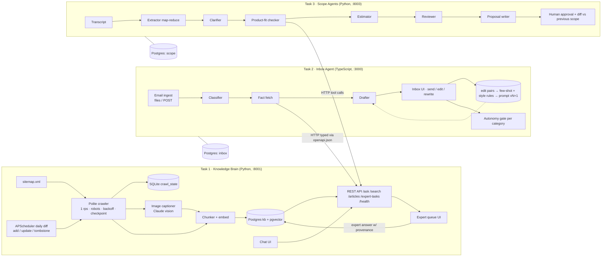

# PLAN — AI Tech Consultant (capstone)

Status: draft for review · 2026-10-18 · No code written yet.

## 1. The business problem (5 sentences)

AI has pushed the price of small software jobs down about 10x, so a services company now has to handle 10–20x the clients with the same people to stay afloat. Writing code is no longer the bottleneck. The time goes into the work around it: knowing the product well, replying to every customer email quickly and correctly, and turning rambling client meetings into a tight, priced scope. Today a senior consultant does all of that by hand, and that doesn't scale. We are building one system that knows the product, drafts the inbox, and turns meetings into scopes and proposals, gets better every week from human edits, and can be pointed at any company's help center, inbox and meetings.

## 2. Needs the client never wrote down

| # | Unstated need | Build / Drop | Why (one line) |
|---|---|---|---|
| 1 | **"Setting vs custom code" price comparison in the proposal**: for each item, show the cost of the existing-setting route next to the custom-build route | **Build** | This is the $200 pricing story in one table. Task 3 already calls Task 1 for it, so it's cheap to add. |
| 2 | **Cost per answer/email/proposal in ₹ and $ on screen**, not just in EVALS | **Build** | Owners care about margin. We log token usage anyway, so it's one column per screen. |
| 3 | **Knowledge-gap report**: the top unanswered questions, grouped, which tells you which help articles to write next | **Build** | Turns the expert queue into a content roadmap. It's one SQL group-by plus a small table. |
| 4 | **Freshness on every citation** ("article updated 3 days ago", or a warning that the article was removed) | **Build** | We already store lastmod and tombstones, and it builds trust in answers. |
| 5 | **Reply in the customer's language** and say clearly when the language isn't supported | **Build** | Non-English emails are in the test mix. It's a prompt rule plus eval cases, with almost no code. |
| 6 | **Scope-creep alarm in the inbox**: an email asking "can you also add X" is flagged against the approved Task 3 scope as a paid extra | **Drop** | Needs a shared client identity across Task 2 and Task 3. Too much plumbing for 4 days. Listed under "next" in DESIGN.md. |
| 7 | **Audit trail**: who approved which reply or proposal, when, from which prompt version and model | **Build** | The approval gates and prompt-version logging already need these rows. We only add a view. |
| 8 | **PII masking in logs and eval exports** (emails, phone numbers) | **Build (minimal)** | A regex masker at log time. Protects us when chat logs and evals are submitted. |
| 9 | **Real mailbox connection (Gmail/IMAP) and real sending** | **Drop** | OAuth and deliverability work add nothing to the score. Use a file/API ingest and an outbox table instead. |
| 10 | **Estimate calibration from actual hours** after projects finish | **Drop** | There are no real actuals to learn from in 4 days. Name it as the next feedback loop. |

## 3. Scoring parts → concrete artifacts

| Part (marks) | Artifacts we must produce |
|---|---|
| **1. Problem thinking (15)** | DESIGN.md Problem + Features chosen/dropped (the table above, with reasons). Needs #1–#5 visible in the demo. `docs/DECISIONS.md`. |
| **2. Design: UI/UX, architecture, agents (20)** | Four screens: KB chat + expert queue (T1), inbox with one-click send + follow-ups + autonomy badges (T2), scope/proposal review with diff + approve (T3). One mermaid diagram in DESIGN.md that matches the compose file. A Task 3 agent table (one job, input type, output type each). `API.md`. |
| **3. Code quality (15)** | Python: type hints, Pydantic v2, async, `ruff` + `mypy --strict` clean. TS: `strict: true`, Zod, types generated from `openapi.json`. pytest/vitest on main paths. `docker compose up` works. One or more commits per milestone on each of the 4 days. |
| **4. Prompts + self-improvement (15)** | `prompts/<name>/vN.md` + `CHANGELOG.md` per task. Every LLM call logs prompt name+version+model. Zod/Pydantic schemas with max-2 retry then human fallback. The Task 2 learning loop (edit pairs → few-shot + style rules → vN+1) with a before/after metric table and a one-command rollback. Expert answers flow into the KB. |
| **5. Evals (20)** | `evals/` per task. ≥20 tuned cases + a held-out set per task. ≥2 models per decision point. A markdown table per run: quality, $/₹ per call, p50/p95 latency, retry/failure rate. Safety cases: injection, empty, garbage, abusive, non-English. `make eval-task1/2/3`. EVALS.md. |
| **6. Writing + demo (15)** | README (≤1 page), DESIGN (3–5 pages), EVALS (2–3 pages), AI_LOG (≤1 page, 5 prompts + 1 rejection). A ≤10-minute video: face for 30s, then T1→T2→T3 working together and one honest failure. Claude Code chat exports kept. |

## 4. Architecture

**Services (docker compose)**

| Service | Port | What | Store |
|---|---|---|---|
| `postgres` (pgvector image) | 5432 | One server, **one database per task** (`kb`, `inbox`, `scope`). No cross-task table access. | volume `pgdata` |
| `task1` | 8001 | FastAPI: REST API + Jinja/HTMX chat UI + expert queue UI. APScheduler daily job runs in-process (single worker). | `kb` DB: articles, chunks (+vectors), images, expert answers. SQLite `crawl_state.db` + downloaded images on volume `kbdata` |
| `task2` | 3000 | Next.js (App Router): inbox UI + API routes. Calls Task 1 from the server side only. | `inbox` DB: emails, classifications, drafts, (draft, final) pairs, autonomy state, follow-ups, outbox |
| `task3` | 8003 | FastAPI + Jinja/HTMX: upload transcript, run the agent pipeline, review/diff/approve. | `scope` DB: transcripts, scope versions, tasks, proposals, approvals |

**How Task 2 and Task 3 call Task 1.** They only use HTTP, at `KB_URL=http://task1:8001` with an `X-API-Key` header.
- **Task 2:** `make gen-types` runs `openapi-typescript` against `task1/openapi.json`, and the generated `kb-api.d.ts` file is committed. A vitest contract test fails if the snapshot drifts from the live spec.
- **Task 3:** a small async `httpx` client with Pydantic response models that mirror the OpenAPI schemas. The Product-fit agent gets `search_kb` / `ask_kb` as Claude **tool calls**, and each tool wraps that client.
- Endpoints used: `POST /ask` (answer, citations, confidence, `answered: bool`), `GET /search` (ranked chunks with article metadata), `GET /articles/{id}`, `POST /expert-tasks`, `GET /health`.
- If Task 1 is down, Task 2 and Task 3 degrade. They mark the item "needs human — knowledge unavailable" and do not draft without facts.

**Pluggability.** A single `tenant.yaml` holds the sitemap URL, company name and voice, email categories, risky categories, hourly rate and currency. That file is the only place "Brilliant Directories" appears.

**Task 3 agents (6, one job each).** All handoffs are Pydantic models.
1. Extractor: `TranscriptChunk[] → Requirement[]` (with speaker + timestamp refs). This is the map step; a reduce step dedupes.
2. Clarifier: `Requirement[] → OpenQuestion[]` (what a senior consultant would ask).
3. Product-fit: `Requirement → FitVerdict{existing_setting|custom, kb_citations}`.
4. Estimator: `Requirement+Fit → TaskEstimate{hours, assumptions}`.
5. Reviewer: checks gaps, double counting and missing assumptions, and returns `ReviewNotes`. It can send one item back once.
6. Proposal writer: `Scope → Proposal` (markdown for the client).

The diff (meeting 2 vs meeting 1) is **deterministic code** over versioned scope items (changed / new / removed / out-of-scope-extra), and it only uses the LLM to match items. Making the diff its own agent would be a seventh agent, which is too many.

## 5. Four-day schedule (riskiest first)

Assumption: day 1 = the first build day. See ambiguity A1 for the deadline.

| Day | Risk-first work | Commit milestones (I suggest messages; you commit) |
|---|---|---|
| **1** | ① **Book the meeting role-plays now.** A human dependency is the top risk: record meeting 1 today or tomorrow. ② Fetch the sitemap and measure the article and image counts (this sets crawl time and captioning cost). ③ Compose skeleton with Postgres + 3 empty services and health checks. ④ Polite crawler with checkpoint, then **start the full crawl in the background**. ⑤ Chunk + embed + `/search`. ⑥ Start writing the 50 emails (you). | `chore: compose skeleton + health` · `feat(t1): polite resumable crawler` · `feat(t1): chunking + search` |
| **2** | ① Image captioning (cost risk: dedupe by hash, skip icons). ② `/ask` with citations, confidence and "I don't know". ③ Daily diff + tombstones, tested with a fixture sitemap. ④ Expert queue → KB. ⑤ API.md + chat UI. ⑥ T1 eval set (25 + 10 held-out) and model compare. ⑦ T2: type gen, classifier + drafter with Zod. ⑧ **Record meeting 2 (follow-up).** | `feat(t1): ask w/ citations + IDK` · `feat(t1): daily diff + tombstones` · `feat(t1): expert loop` · `eval(t1): …` · `feat(t2): classify + draft via KB API` |
| **3** | ① T2 learning loop + autonomy + revocation + follow-ups + inbox UI. ② T2 evals incl. injection/abuse/non-English. ③ T3 agents end to end on meeting 1, then the diff on meeting 2. ④ **Record meeting 3.** | `feat(t2): edit learning + prompt vN+1` · `feat(t2): earned autonomy` · `eval(t2): …` · `feat(t3): agent pipeline` · `feat(t3): scope diff` |
| **4** | ① T3 evals (per agent + end to end). ② Safety pass across all three tasks. ③ Hidden-test hardening: run unseen inputs we write that morning and don't tune on them. ④ README/DESIGN/EVALS/AI_LOG. ⑤ Demo video incl. a failure. ⑥ Clean `docker compose up` from a fresh clone. | `eval(t3): …` · `docs: design/evals/readme/ai_log` · `chore: fresh-clone run verified` |

**Cut order if behind:** MCP wrapper → knowledge-gap report → PII masker polish → Task 3 Reviewer loop-back. These four stay no matter what: evals, approval gates and one-command run.

## 6. Ambiguities — your decision needed

Each item gives the options and my recommendation (★).

| # | Question | Options and trade-offs |
|---|---|---|
| A1 | **When does the 4-day clock end?** The brief is dated Oct 14 and today is Oct 18. | (a) Deadline already passed or is today, so we cut hard. (b) The clock started when you opened it, so tell me the end date. This decides the whole schedule. |
| A2 | **Embeddings** (Claude has no embedding model) | (a) ★ Local `bge-small` via fastembed: free, offline, adds ~200 MB to the image, and needs a recall@5 eval vs BM25 to justify a non-Claude model. (b) Voyage API: better quality, but needs a key, a cost and an extra vendor. (c) No vectors: Postgres full-text + Claude rerank. Simplest and fully Claude-centred, but weaker on paraphrases. |
| A3 | **Vector / data store** | (a) ★ Postgres + pgvector, one server with a DB per task. A single store for everything. (b) Chroma + SQLite: lighter, but two stores to explain. CLAUDE.md already fixes crawl state in SQLite. Keep that? |
| A4 | **Image captioning scope** | (a) ★ All content images, deduped by hash, skipping images under ~100 px or reused across more than 20 pages (logos), with Haiku vs Sonnet compared on 25 images. (b) Only the first N images per article, which caps cost but misses answers. |
| A5 | **"Same kind" for autonomy** | (a) ★ Same `category`. Simple and explainable, and gets to 20 in a row faster. (b) `category + intent`: safer, but may never reach 20 inside a demo. |
| A6 | **"Unchanged"** | (a) ★ Normalized char edit distance ≤ 0.02 after trimming whitespace, signature and greeting. (b) Exact match after normalization: strictest. (c) Semantic similarity: lenient and hard to explain. |
| A7 | **Losing autonomy** | (a) ★ Any send with distance > 0.02, any complaint, or any failed eval revokes it, and the counter goes back to 0. (b) Allow a rolling 1-in-20 tolerance: less brittle, but harder to defend. |
| A8 | **Prompt version bump from learning** | (a) ★ The system proposes vN+1 (few-shots + style rules) and a human approves it after an eval comparison. Rollback = pointer switch. (b) Automatic bump nightly: more "self-improving", but risky and harder to undo cleanly. |
| A9 | **How emails come in, and where "sent" goes** | (a) ★ File drop `data/emails/*.json` + `POST /api/emails`. "Sent" = outbox table. (b) Add Mailpit so sent mail shows in a fake mailbox: nicer demo, one more container. |
| A10 | **Hidden test input formats** | Emails: JSON vs .eml vs plain text? Transcripts: .txt vs .vtt/.srt? ★ Accept all of them with a small normalizer per format, and document the formats in README. |
| A11 | **Turning meeting recordings into transcripts** | (a) ★ Built-in transcript from Meet/Zoom, done outside the system. No non-Claude model in our code. (b) Local Whisper: better speaker labels, but it's a non-Claude model to justify. |
| A12 | **MCP** (listed as a core skill for Tasks 2 and 3) | (a) ★ Claude tool-calling over HTTP now; a thin MCP server for Task 1 only if Day 4 allows. (b) MCP-first: more marks on that skill, more setup risk. |
| A13 | **Task 3 framework** | (a) ★ Plain async Python orchestrator + Anthropic SDK. Each line can be explained. (b) Claude Agent SDK: less code, more magic in the live review. (c) LangGraph/CrewAI: a new framework, which CLAUDE.md discourages. |
| A14 | **Eval budget for Task 3's 6 agents** (2 models × 20 cases × 6 agents is expensive) | (a) ★ Per-agent model compare on 20 small cases for the 3 agents where the model choice matters (Extractor, Product-fit, Estimator); the rest use the cheaper model, justified by end-to-end quality. (b) Full per-agent comparison for all 6. |
| A15 | **LLM judge** | (a) ★ An Opus judge with a written rubric, plus 20% of cases hand-labelled by you to report judge agreement. (b) Human-only labels: most honest, but slow. |
| A16 | **Pricing basis in proposals** | What hourly rate and currency? (₹ and $ both, ★ rate in `tenant.yaml`). Should the proposal show the "setting vs custom" saving (need #1)? |
| A17 | **Auth** | (a) ★ One API key header on Task 1, no user login on the UIs. (b) Basic login per UI: more realistic, but adds time. |
| A18 | **Non-English emails** | (a) ★ Reply in the customer's language, with the human approving. (b) Reply in English and flag it. |
| A19 | **Showing the daily refresh in the demo** | (a) ★ Admin "run diff now" button + a fixture sitemap with 1 add, 1 change and 1 removal. (b) Wait for the real daily change: unreliable on camera. |
| A20 | **Page budget** | CLAUDE.md docs total 7–10 pages, inside the brief's 6–10 limit. Do PLAN.md and DECISIONS.md count? ★ Treat them as internal and exclude them from the count. |
| A21 | **Language bonus** | CLAUDE.md fixes Task 2 in TypeScript (for the "both languages" bonus). Confirm. TS adds risk on Day 2–3. |
